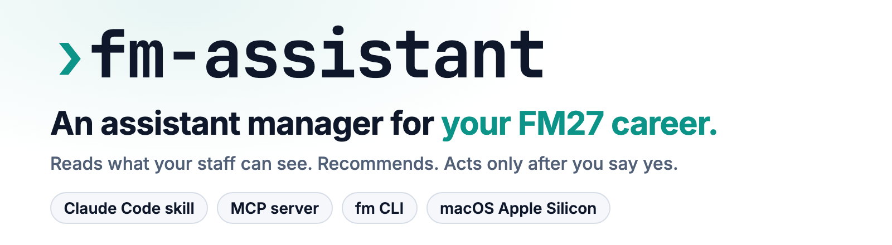
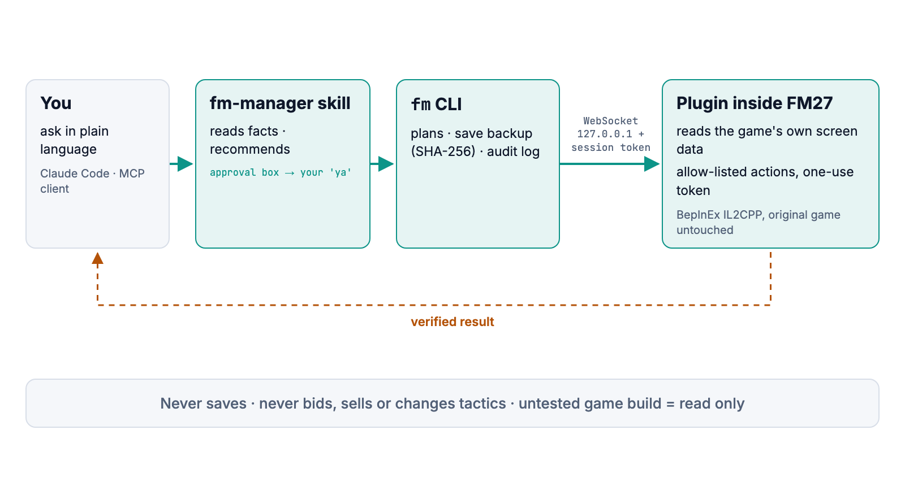

<div align="center">

<picture>
  <source media="(prefers-color-scheme: dark)" srcset="docs/assets/banner-dark.png">
  
</picture>

### An assistant manager for your Football Manager 27 career, inside Claude Code

**[Quick start ↓](#quick-start)** &nbsp;·&nbsp; **[Install ↓](#install)** &nbsp;·&nbsp; **[Commands ↓](#commands)** &nbsp;·&nbsp; **[Protocol →](docs/protocol.md)**


[](LICENSE)

</div>

A Football Manager career runs on dozens of screens. Contracts ending, injured players' return dates, open staff
jobs, who is tired before a busy week, which Player Database rows fit the wage room: each lives on its own screen,
and the game never puts them side by side. You click through Staff Search, Squad, Training and the inbox before
every session, and still miss the contract that ran out or the scout job that stayed open.

fm-assistant reads those screens for you from the running game and answers in plain language:

- **Reads what your staff can see.** A plugin inside the game reads the same data the screens bind to. Unscouted
  players stay `-` or `6-10`, never their hidden values.
- **Recommends, with the numbers.** Staff for each open job, targets for thin positions within budget, contract and
  injury watch, form, fixtures, loans, rotation options, and what changed since last time.
- **Acts only after you say yes.** Staff offers, shortlist, training sessions and contract renewals go through a plan
  you approve. Every apply backs up the save (SHA-256) first and logs the verified result.
- **Leaves the game alone.** It never saves, bids, sells or changes tactics. The original game app is untouched, and
  an untested game build is read only.

<picture>
  <source media="(prefers-color-scheme: dark)" srcset="docs/assets/diagram-dark.png">
  
</picture>

## Quick start

**1. Install** (after the BepInEx loader, see [Install](#install))

```bash
git clone <this repo> fm-assistant && cd fm-assistant && bash scripts/install.sh
```

**2. Check**: start FM27 from Steam, load your career, then

```bash
fm doctor
```

**3. Ask** in Claude Code

```
/fm-briefing
ada scout bagus yang muat di budget?
```

The skill answers in Indonesian.

## Install

Needs an Apple Silicon Mac, FM27 on Steam, [uv](https://docs.astral.sh/uv/) and the
[.NET 6 SDK](https://dotnet.microsoft.com/download) (to build the plugin).

1. Install the sptndc FM27 BepInEx loader (macOS arm64): put its `FM27-BepInEx` folder next to `fm.app`, set the
   Steam launch option its README gives, start the game once and quit. The loader makes its own copy of the game
   and rebuilds it after Steam updates; the original `fm.app` is not modified.
2. `bash scripts/install.sh` builds and installs the plugin, installs the `fm` CLI (`uv tool`), and copies the
   `fm-manager` skill and its slash commands into `~/.claude`. Options: `--mcp` (also `fm-mcp`), `--no-skill`.
   It checks the Steam launch option but never edits Steam's settings. Re-run it after `git pull` to update.
3. Merge `~/.claude/skills/fm-manager/settings.example.json` into your Claude Code settings: read commands run
   without prompts, every `fm apply` asks you first.

Uninstall: `bash scripts/uninstall.sh` (quit the game first). It removes the plugin, CLI and skill and keeps your
save backups in `~/.fm-assistant/backups`; `--purge` also removes plans, the audit log and snapshots.

Back up your save folder before trying anything new; the loader is third-party.

## Commands

| Command | What you get |
|---|---|
| `fm doctor` | loader, plugin, game build, career, one read per feature |
| `fm briefing` | one-screen session summary: next match, injuries, tired, contracts, concerns, form, vacancies, loans |
| `fm fixtures [--n 5]` | upcoming matches (home/away, competition) and the assistant's note on the next opponent |
| `fm club budget` | balance, transfer budget, wage budget / committed / headroom, staff slots |
| `fm squad list [--team first\|reserve\|youth]` | players, positions, condition, injuries |
| `fm squad watch [--within 180]` | contracts ending soon; injured players' return date and matches missed |
| `fm squad depth` | fit players per position against your minimums (`~/.fm-assistant/depth.json`, default 2); no formations |
| `fm squad contracts` | squad status, contract end, release clause, against the game's wage structure |
| `fm squad form` | season appearances and rating, last five matches, unhappy players, club atmosphere |
| `fm squad loans` | players out on loan with their games and rating; youth intake date |
| `fm staff search --role scout [--top 10]` | Staff Search rows ranked for a role (`staff_roles.json`, overridable in `~/.fm-assistant/`) |
| `fm staff slots` | staff slots per department, with the board's view |
| `fm staff vacancies [--top 3]` | open staff jobs, each with the best Staff Search candidates for it |
| `fm players search [--affordable]` | Player Database rows within your budget, as your scouts know them |
| `fm players targets [--top 5]` | affordable Player Database rows for each thin position |
| `fm training show [--weeks 2]` / `fm training load` | the training calendar; sessions and matches per week, tired players |
| `fm inbox [--unread] [--since DATE]` | inbox messages, newest first; `*` unread, `!` important |
| `fm tactic` | the active tactic's slots, roles and players; who is out of position, injured or tired (facts only) |
| `fm squad rotation [--days 7]` | before congested fixtures: XI players injured or tired, with fitter options per slot |
| `fm snapshot` / `fm trends` | save today's club and squad state; compare with the latest earlier snapshot (`~/.fm-assistant/snapshots/`) |

Add `--json` before the command for machine output. `scripts/smoke.sh` runs all of them against the live game.

## Actions (after approval)

The assistant can do a few things in the game, only through a plan you approve:

| Kind | What it does |
|---|---|
| `staff.approach` / `staff.offer` | open contract talks with a staff member; send one offer at a wage up to the board's maximum |
| `shortlist.add` / `shortlist.remove` | add a player to, or take one off, the shortlist |
| `scout.request_report` | ask one of your scouts for a report on a player |
| `training.set_sessions` / `training.set_focus` | change sessions in the training calendar; set a player's individual focus |
| `contract.open_renewal` / `contract.offer_renewal` | open renewal talks with your own player; send the terms you approved, once |

```bash
fm plan create shortlist.add --arg uid=123456 --reason "winger cover"   # writes a plan, nothing happens yet
fm plan show <id>
fm apply <id>          # backs up the newest save, performs each action, reads the result back
fm log --n 5           # audit log (~/.fm-assistant/log.jsonl)
```

- Only the kinds above exist; the plugin also checks a one-use token that only `fm apply` writes. It never accepts
  bids, sells, releases, terminates contracts or changes tactics, and it never answers a counter-offer by itself.
- Before acting, `fm apply` copies the newest save to `~/.fm-assistant/backups/<time>/` with a SHA-256. The game
  holds the changes in memory until you save. **Rollback = load a save from before the change**; once you have
  saved, the backup copy is the only way back (copy it over the save in the game's `games/` folder with the game
  closed).
- Actions refuse to run on an untested game build.
- `settings.example.json` lets the skill write plans and read the log on its own, and asks you before every
  `fm apply`.

## MCP server

Read tools plus `propose` (writes a plan), `plan_show`, `log` and `apply`. `apply` changes the game: the client
must ask you before each call. There are no tools that launch, restart, load or call anything else in the game.

`fm-mcp` runs over stdio; each tool runs `fm --json ...`, and errors come back as `{"ok": false, "error": {...}}`.

```bash
bash scripts/install.sh --mcp
claude mcp add fm-assistant -- fm-mcp
```

Claude Desktop (`~/Library/Application Support/Claude/claude_desktop_config.json`; use the full path from
`which fm-mcp`):

```json
{"mcpServers": {"fm-assistant": {"command": "/Users/you/.local/bin/fm-mcp"}}}
```

New CLI commands become tools by adding one `Tool(...)` line to `TOOLS` in `fm/src/fm_assistant/mcp_server.py`.

## Unsupported game builds

The plugin is tested against specific game builds (`fm doctor` lists them). On another build every command
still runs but warns on stderr, and the skill says the numbers may be wrong. Game updates can rename the
properties the plugin reads; reads then fail with a clear error instead of guessing.

## Known gaps

- Staff wage demands appear only once talks are open (`staff.approach`); searches show current wages.
- Player search returns the Player Database's current filter.
- The training view covers the month the Training screen shows.
- Scout report requests and individual training focus exist in the plugin but the skill leaves them manual: no read
  shows your scouts' ids or the focus option names yet.


## Why fm-assistant

- **Live data, not a save-file dump.** Save parsers show a frozen copy and the true hidden values; this reads the
  running game, as your staff know it, and is current after every Continue.
- **Any game language.** Screens are opened by internal panel id and data is read by property name, never by
  on-screen text.
- **Human in the loop by construction.** A closed list of action kinds in the CLI, allow-listed game actions in the
  plugin, a one-use token per action, a save backup before each apply, and an audit log. A chat window that clicks
  for you has none of these.
- **Survives game updates honestly.** Bindings are looked up by name; an untested build warns, turns actions off,
  and fails with a clear error instead of guessing.

## Development

- `cd fm && uv run pytest` (unit tests, no game needed); `bash scripts/smoke.sh` runs every read command against the
  live game (never applies anything).
- `bash plugin/build.sh` builds the plugin; ops reload into the running game without a restart.
- `docs/protocol.md` documents the plugin protocol and what was discovered about the game's data.

## Credits

fm-dof-mcp (MIT): binding read patterns and the position bit table. cli-anything-fm27 (Apache-2.0): save
parsing used in development checks. sptndc's FM27 BepInEx loader. See `NOTICE`. Not affiliated with the
makers of Football Manager.

## License

MIT, see [LICENSE](LICENSE).
